 

# Tulsi Kumar Yadav

### Software Engineer · AI/ML Engineer · LLM & RAG Developer

*Building practical AI applications and reliable backend systems.*

  
  
  

## About Me

I'm a 2026 Computer Science and Engineering (Data Science) graduate from AMC Engineering College, affiliated with Visvesvaraya Technological University (VTU).

My project work focuses on building full-stack applications, Python backend services, machine learning solutions, and LLM-powered systems. I enjoy turning technical ideas into practical applications through thoughtful API design, data-driven workflows, and maintainable software.

- **Backend Engineering:** Python, Django, FastAPI, REST APIs, and SQL.
- **AI/ML Engineering:** Machine learning, Generative AI, LLMs, and RAG workflows.
- **Full-Stack Development:** JavaScript, HTML, CSS, Bootstrap, and database integration.
- **Applied AI:** Semantic search, document intelligence, and multimodal AI applications.

I'm interested in opportunities where I can contribute to real engineering problems, strengthen my technical skills, and build useful software.

## Featured Projects

### 01 — JanMitra
**AI-Powered Civic Issue Reporting Platform**

A full-stack civic-tech application that helps citizens report and track civic issues while supporting government-side review and resolution workflows.

- Developed issue submission, status tracking, notifications, rewards, search, and filtering.
- Built relational data models and backend workflows using Django ORM and SQL.
- Integrated Gemini APIs for AI-assisted issue classification and text, image, and voice-based reporting.
- Created a location-based issue visualization interface using Leaflet.

**Stack:** Python · Django · JavaScript · HTML5 · CSS3 · SQL · Gemini API · Leaflet

[View Repository](https://github.com/tulsikumar18/JanMitra) · [Live Demo](https://janmitra-in-django.onrender.com)

---

### 02 — Swasthya Margadarshika
**ML-Powered Healthcare Platform**

A healthcare-oriented application that combines symptom analysis, machine learning-based disease prediction, and dataset-driven health recommendations.

- Developed REST APIs using FastAPI and Pydantic validation.
- Implemented disease prediction using an ensemble of SVC, MultinomialNB, and Random Forest.
- Integrated Gemini API for symptom interpretation.
- Implemented recommendation workflows for medications, precautions, diet, and lifestyle.
- Added session management, environment-based configuration, and pytest testing.

**Stack:** Python · FastAPI · Scikit-learn · JavaScript · HTML · CSS · Bootstrap · Pydantic · Gemini API

[Open Live Demo](https://swasthya-margadarshika.onrender.com)

*This project is for educational and informational purposes and is not a substitute for professional medical advice.*

---

### 03 — LLM-Based Regulatory Intelligence System
**Document Processing & Semantic Retrieval**

An AI application designed to process regulatory documents and generate structured compliance insights through document ingestion, semantic retrieval, and LLM-based processing.

- Built document ingestion and preprocessing workflows for PDF and HTML files.
- Implemented semantic search using Sentence Transformers and FAISS.
- Developed modular processing workflows for structured outputs and regulatory insight extraction.
- Used API-driven and JSON-based processing to organize document analysis.

**Stack:** Python · FastAPI · LLMs · RAG · Sentence Transformers · FAISS

[View Repository](https://github.com/tulsikumar18/AI-Assisted-regulatory-For-Corep)

---

### 04 — AgriAid
**AI-Powered Agricultural Assistant**

A multimodal agricultural assistant developed to make AI-powered agricultural support more accessible through text, image, voice, and multilingual interactions.

- Built workflows for processing different user input types.
- Integrated external AI services to generate assistance and recommendations.
- Developed multilingual and voice-based interaction features.
- Collaborated on debugging, testing, and improving application functionality.

**Stack:** Python · FastAPI · Computer Vision · NLP · Gemini API

**Achievement:** First place among 50+ teams in a hackathon.

[View Repository](https://github.com/tulsikumar18/AgriAid) · [Watch Demo](https://drive.google.com/file/d/13oJG7U6W43YkJlChiFagw9NCBynm2deI/view?usp=sharing)

## Technical Skills

### Programming Languages

  
  
  

### Frontend Development

  
  
  
  

### Backend & APIs

  
  
  
  
  

### Databases

  
  
  
  

### AI, Machine Learning & Generative AI

  
  
  
  
  
  
  
  
  
  

### Developer Tools & Core CS

  
  
  
  
  
  

Additional areas: DBMS, SDLC, SQL query optimization, debugging, software testing, API integration, and problem-solving.

## Education

**B.E. — Computer Science and Engineering (Data Science)**

AMC Engineering College · Bengaluru, Karnataka

Affiliated with Visvesvaraya Technological University (VTU)

- **Graduation:** July 2026
- **GPA:** 8.74/10

## Achievements & Certifications

- **Hackathon:** First place among 50+ teams for AgriAid.
- **IVIS Labs Promptathon — March 2025:** Developed an AI-powered workflow for converting handwritten notes and diagrams into structured presentation slides.
- **IBM Certified SQL Developer — 2024.**
- **Oracle Certified Generative AI Professional — 2025.**

## GitHub Contributions

*Contribution visualization provided by the external ghchart service. Availability and rendering depend on that service.*

## Let's Connect

I'm interested in software engineering, Python backend development, AI/ML applications, and practical Generative AI projects.

<a href="mailto:tulsikumaryadavamcec@gmail.com">**Email Me**</a>
&nbsp; · &nbsp;
<a href="https://www.linkedin.com/in/tulsi-kumar-yadav-2b749627a">**LinkedIn**</a>
&nbsp; · &nbsp;
<a href="https://github.com/tulsikumar18">**GitHub**</a>
&nbsp; · &nbsp;
<a href="https://github.com/tulsikumar18/Leetcode_problems_and_solutions">**Coding Practice Repository**</a>

 

